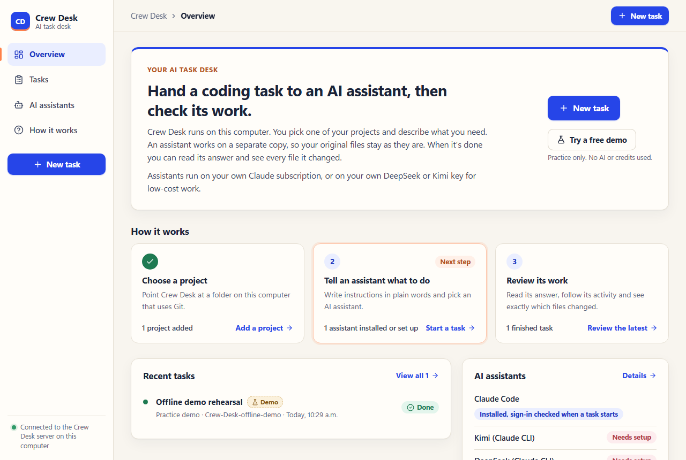

# Crew Desk

Hand bounded coding tasks to low-cost AI models such as DeepSeek, then check their work before any of it touches your project.

Crew Desk is a small dashboard and task queue that runs on your own computer. Your main AI coding session (Claude Code, Codex, or you in the browser) plans the work and writes a short brief. Crew Desk starts a worker for that brief on a separate copy of your repository, keeps it inside a spending limit, and shows you the worker's report and the exact diff. Nothing is merged, committed or pushed for you.



Workers run through the Claude Code program, so they get its full tool loop. The model behind them is your choice:

| Lane | Model | Paid through | Good for |
| --- | --- | --- | --- |
| **DeepSeek** | `deepseek-flash` (V4.1 Flash) | your DeepSeek API balance | routine, clearly described tasks; about US$0.10 a run in our own use |
| **Kimi** | `kimi-k3` | your Kimi API balance | harder work across several files |
| **Claude** | `sonnet` or `haiku` | your Claude subscription | when you would rather not spend API money |
| **Demo** | none | free | a pre-written practice task, so you can see the whole flow first |

**Start with [SOP.md](SOP.md).** It is the step-by-step procedure: setup, which lane to pick, how to write a brief, how to run a task, and how to review and bring the work in.

## What you need

- [Node.js](https://nodejs.org) 22 or newer, and [Git](https://git-scm.com).
- [Claude Code](https://code.claude.com/docs/en/setup): `npm install -g @anthropic-ai/claude-code`. Crew Desk runs it as the worker program, also for DeepSeek and Kimi.
- A [DeepSeek API key](https://platform.deepseek.com/api_keys) with a small balance (a few dollars goes a long way). Optional: a Kimi key, or a Claude subscription.

Crew Desk was built and tested on Windows. It should run on macOS and Linux, but those are less tested.

## Quick start

```bash
git clone https://github.com/mani-kanasani/crew-desk-community.git
cd crew-desk-community
npm install
npm run build
```

Copy `.env.example` to `.env.local` and paste your key after `DEEPSEEK_API_KEY=`. Then start the server:

```bash
npm start
```

Open http://127.0.0.1:4317 and press **Try a free demo**. On Windows PowerShell, use `npm.cmd` in place of `npm` if PowerShell refuses to run scripts.

Keep the server running while you use the dashboard, the CLI or the MCP tools. Restart it after you change `.env.local`.

## Use it from your lead AI session

The CLI talks to the same queue as the dashboard:

```bash
node bin/crew.mjs status                        # lanes, projects, runs
node bin/crew.mjs project "/path/to/your/repo" "My app"
node bin/crew.mjs run task.json                 # queue a task
node bin/crew.mjs show RUN_ID                   # status and the worker's report
node bin/crew.mjs patch RUN_ID                  # write the change as a .patch file
node bin/crew.mjs budget                        # what each paid lane has left
```

There is also an MCP server for agents that prefer named tools (`crew_status`, `crew_project_add`, `crew_run`, `crew_result`, `crew_diff`, `crew_cancel`, `crew_demo`). Point your MCP client at `node /absolute/path/to/crew-desk-community/bin/mcp.mjs`; `mcp-config.example.toml` shows the Codex form. SOP.md section 12 has a block you can paste into your lead session's instructions.

## How it keeps you safe

- **A fixed snapshot.** Each task runs on a pinned commit in its own Git worktree. Your working files are never touched.
- **A spending guard.** Paid tasks reserve money from a local ledger before they start (default limits: US$5 DeepSeek, US$10 Kimi; change them with `node bin/crew.mjs allocation deepseek 20 "my budget"`). A run is stopped when its estimate reaches the task's target. One paid run per provider at a time.
- **Isolated keys.** A worker gets only its own provider key. Everything else that looks like a credential is stripped from its environment, and keys never reach the browser.
- **A scope check.** Edit tasks list the files they may change; the review flags anything outside that list.
- **You decide.** A worker's report is a claim to check. You read the diff and apply it yourself.

The ledger limits what Crew Desk sends; it is not a cap on the provider's side. A worktree separates Git changes, but it is not a security sandbox: workers can run commands on your computer, so only register repositories you trust.

## Paid lanes in detail

- **Admission:** a paid task is queued only after it reserves its budget target plus headroom for two worst-case calls. It is refused if that would exceed the lane's allocation or the per-task cap (US$2 DeepSeek, US$10 Kimi), or while another paid run on that provider is active.
- **In flight:** usage streams from the worker, and Crew Desk stops it when the estimate reaches the target or one call grows past the context bound.
- **Settlement:** complete usage settles at an estimate (tokens times published rates). Incomplete usage, a stop, a timeout or a restart leaves the entry **uncertain** until you reconcile it with `node bin/crew.mjs reconcile ENTRY_ID ACTUAL_USD "source"`.
- **Prices** live in `server/provider-pricing.json`, checked on 21 September 2026. If a provider changes its prices or model names, update that file; a lane with missing or unverified pricing pauses itself rather than guessing.

## Settings

All optional, in `.env.local`:

| Name | Default | What it does |
| --- | --- | --- |
| `DEEPSEEK_API_KEY` | | turns on the DeepSeek lane |
| `DEEPSEEK_MODEL` | `deepseek-flash` | the DeepSeek model ID |
| `MOONSHOT_API_KEY` | | turns on the Kimi lane |
| `KIMI_MODEL`, `KIMI_EFFORT` | `kimi-k3[1m]`, `max` | the Kimi model and reasoning effort (`low`, `high`, `max`) |
| `HARNESS_PORT` | `4317` | the dashboard port |
| `CLAUDE_BIN` | found automatically | path to the Claude Code program |

The Claude lane uses your normal `claude auth login`; Crew Desk never falls back to the paid Anthropic API.

## Development

```bash
npm test
npm run build
npm run dev      # the dashboard with live reload at http://127.0.0.1:4318 (run npm start alongside)
```

The tests use local fixtures and never spend API credits.

## Licence

MIT. See [LICENSE](LICENSE). Third-party packages keep their own licences.
